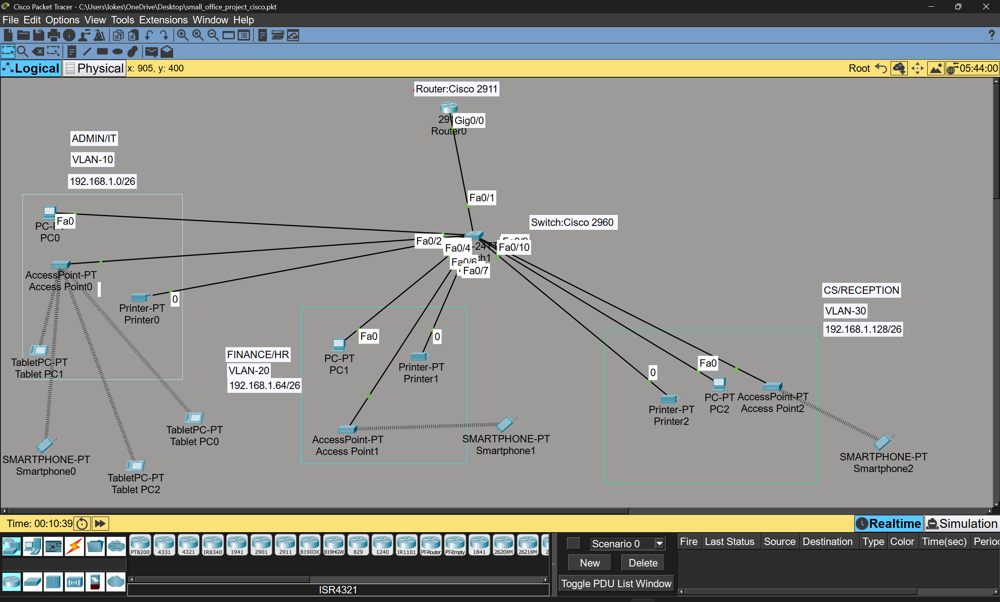

# SOHO Network Design Using Cisco Packet Tracer

A Small Office Home Office (SOHO) network designed and implemented using Cisco Packet Tracer.

The project demonstrates VLAN segmentation, IPv4 subnetting, Router-on-a-Stick inter-VLAN routing, DHCP configuration, and wireless connectivity for three departments.

## Network Topology

## Project Overview

This project focuses on designing a small office network for three departments:

- ADMIN/IT
- FINANCE/HR
- CS/RECEPTION

Each department is assigned a separate VLAN and IP subnet to organize network communication.

A Cisco 2911 router and Cisco 2960 switch are used to implement the network infrastructure.

## Project Objectives

- Design a departmental network using Cisco Packet Tracer.
- Implement VLANs for network segmentation.
- Configure IPv4 addressing and subnetting.
- Implement Router-on-a-Stick inter-VLAN routing.
- Configure DHCP pools for automatic IP address assignment.
- Connect wired and wireless devices.
- Perform basic network connectivity testing.

## Technologies and Devices Used

| Technology / Device | Purpose |
|---|---|
| Cisco Packet Tracer | Network design and simulation |
| Cisco 2911 Router | Inter-VLAN routing and DHCP |
| Cisco 2960 Switch | VLAN management and device connectivity |
| VLAN | Logical network segmentation |
| IEEE 802.1Q | VLAN trunking |
| DHCP | Automatic IP address assignment |
| IPv4 Subnetting | Network address allocation |
| Wireless Access Points | Wireless connectivity |

## Network Segmentation

The network is divided into three departmental VLANs.

| Department | VLAN ID | Network Address | Default Gateway |
|---|---:|---|---|
| ADMIN/IT | 10 | 192.168.1.0/26 | 192.168.1.1 |
| FINANCE/HR | 20 | 192.168.1.64/26 | 192.168.1.65 |
| CS/RECEPTION | 30 | 192.168.1.128/26 | 192.168.1.129 |

**Subnet Mask:** 255.255.255.192 (/26)

Each subnet provides 62 usable host addresses.

## Key Configurations

### 1. VLAN Configuration

Three VLANs were created on the Cisco 2960 switch:

- VLAN 10 – ADMIN_IT
- VLAN 20 – FINANCE_HR
- VLAN 30 – CS_RECEPTION

### 2. Trunk Configuration

The connection between the router and switch uses IEEE 802.1Q trunking through FastEthernet0/1.

### 3. Inter-VLAN Routing

Router-on-a-Stick was implemented using three router subinterfaces:

- GigabitEthernet0/0.10
- GigabitEthernet0/0.20
- GigabitEthernet0/0.30

### 4. DHCP Configuration

Three DHCP pools were configured on the router to provide automatic IP addresses to devices in their respective departmental networks.

### 5. Wireless Connectivity

Wireless access points were included to provide wireless network connectivity for mobile devices.

## Connectivity Testing

Basic connectivity testing was performed using ICMP ping commands.

The captured test screenshots are available in the `Screenshots` folder.

The tests cover wired and wireless device connectivity.

## Project Screenshots

All network configuration and implementation screenshots are available here:

[View Project Screenshots](Screenshots/)

The screenshots include:

- Network topology
- VLAN configuration
- Trunk configuration
- Router configuration
- Router-on-a-Stick configuration
- DHCP pool configuration
- DHCP bindings
- IP address configuration
- Wireless configuration
- Connectivity testing

## Project Files

The original Cisco Packet Tracer simulation file is available here:

[Download Packet Tracer Project](Packet-Tracer-File/small_office_project_cisco.pkt)

**Requirements:** Cisco Packet Tracer must be installed to open and explore the `.pkt` file.

## Documentation

Detailed project documentation is available below:

| Document | Description |
|---|---|
| [Network Architecture](Documentation/Network_Architecture.md) | Network design and architecture |
| [IP Addressing Table](Documentation/IP_Addressing_Table.md) | IPv4 addressing and subnetting details |
| [Configuration Commands](Documentation/Configuration_Commands.md) | Cisco router and switch commands |

## Learning Outcomes

Through this project, I gained practical experience in:

- Network design and topology creation.
- VLAN configuration and segmentation.
- IPv4 addressing and subnetting.
- Router-on-a-Stick inter-VLAN routing.
- DHCP configuration and verification.
- Switch trunk configuration.
- Wired and wireless network connectivity.
- Basic network troubleshooting.

## Conclusion

This project provided hands-on experience in designing and configuring a departmental SOHO network using Cisco Packet Tracer.

It demonstrates the practical application of fundamental networking concepts through network simulation, device configuration, and connectivity testing.

---

**Project Type:** Networking / Cisco Packet Tracer

**Tools:** Cisco Packet Tracer

**Author:** Lokesh Kalidindi
